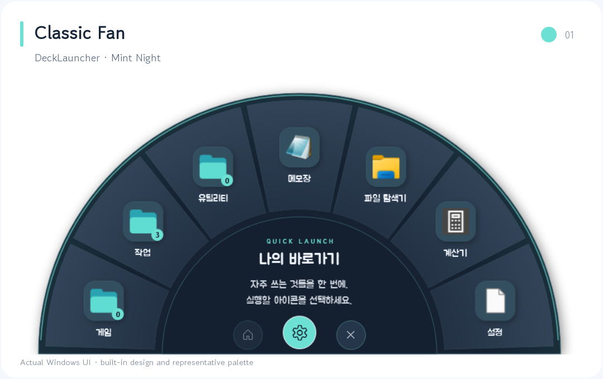
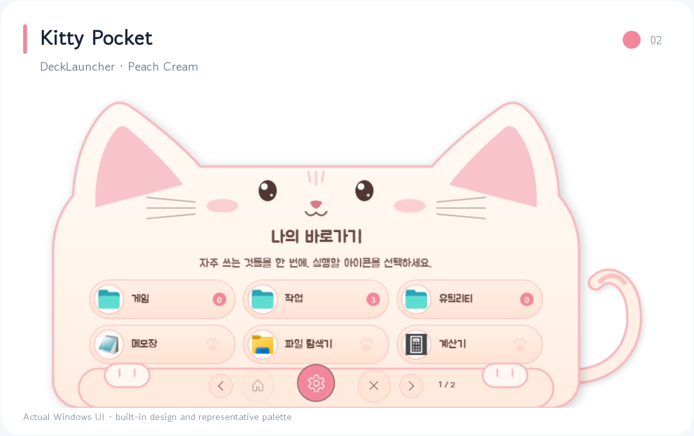
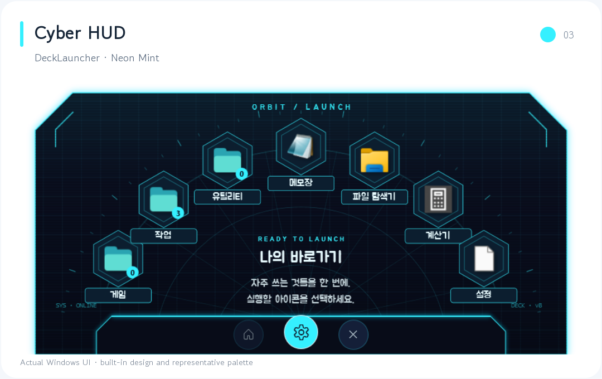
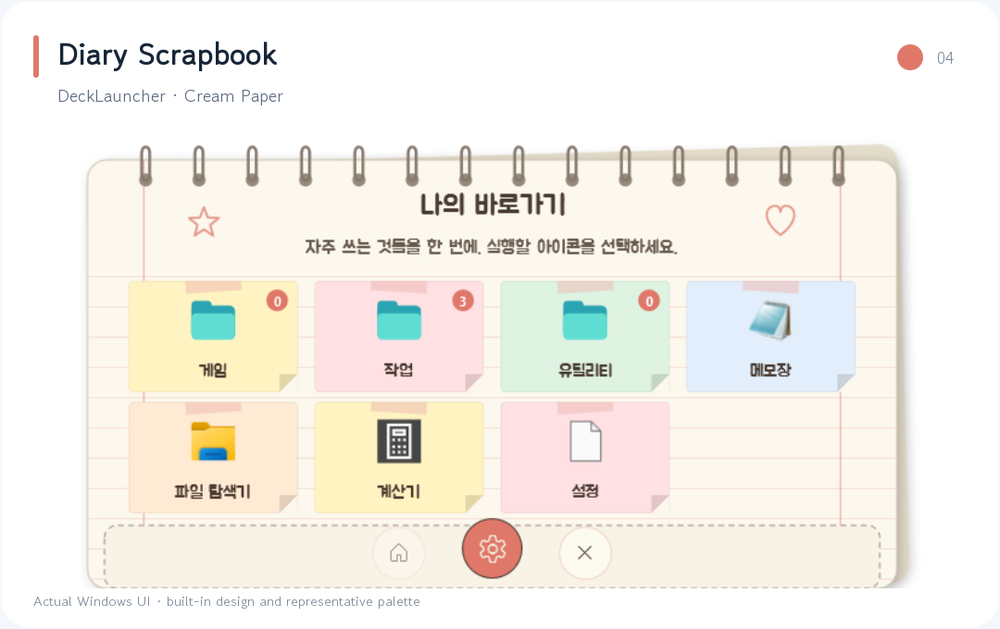
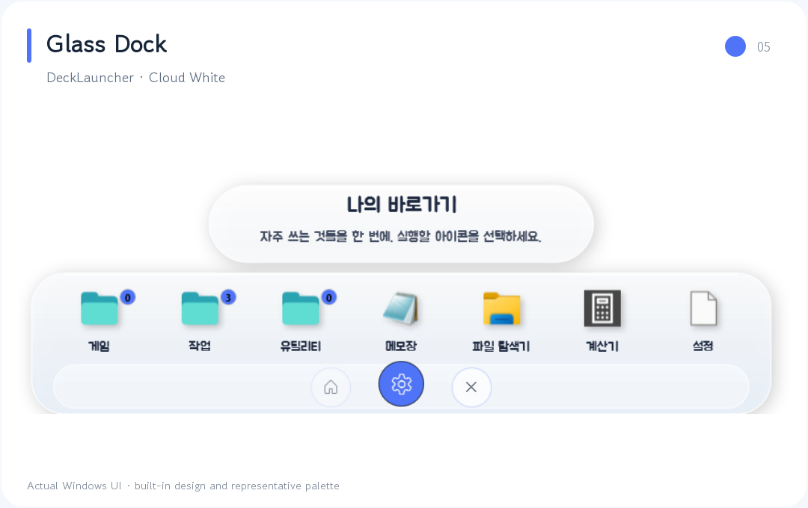
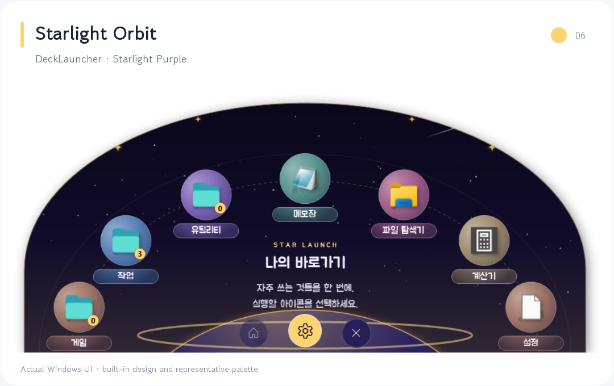
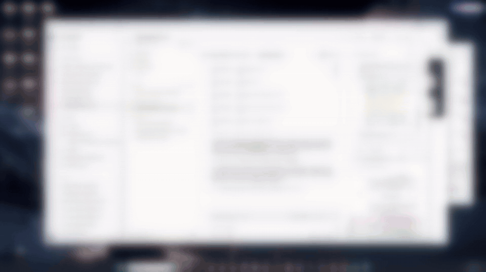
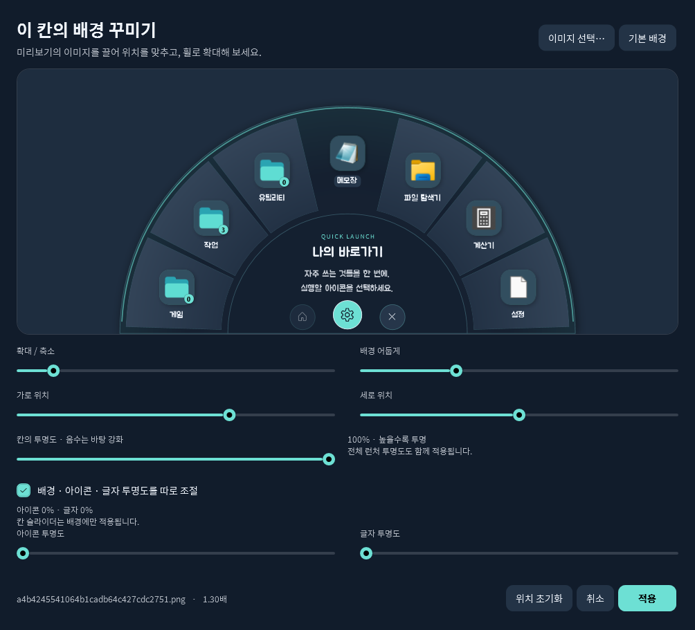
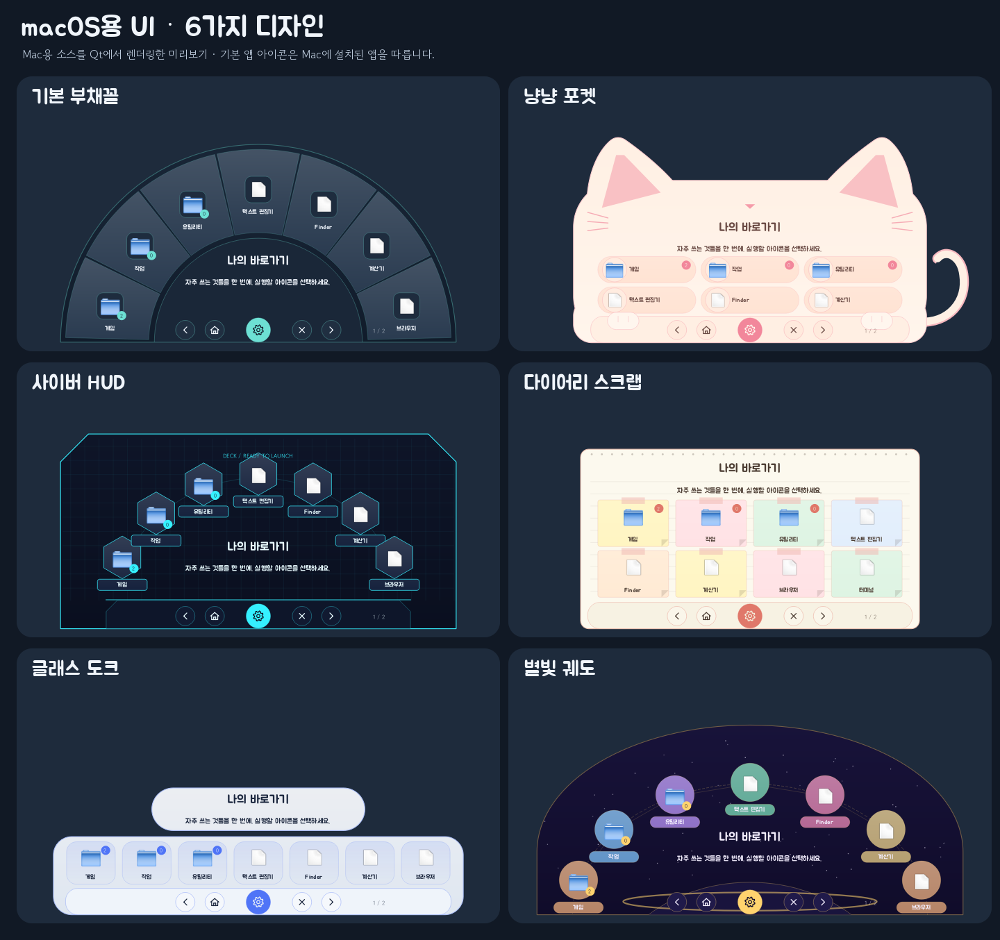

# Taskbar Launcher (DeckLauncher)

[한국어](README.md) · **English** · [日本語](README.ja.md) · [简体中文](README.zh-CN.md)

Click the taskbar icon to open an app launcher in a fan shape or your chosen design. Group frequently used apps into folders and customize icons, notes, backgrounds, colors, and fonts. Windows and Qt/Python-based Linux and macOS versions are available.

## Theme previews

**Choose colors and UI designs independently.** These previews are rendered from the actual Windows launcher, using one representative palette for each design. Click an image to enlarge it. The app UI is currently in Korean; the language links above switch the README translation.

| Classic Fan · Mint Night | Kitty Pocket · Peach Cream |
|:---:|:---:|
|  |  |
| **Cyber HUD · Neon Mint** | **Diary Scrapbook · Cream Paper** |
|  |  |
| **Glass Dock · Cloud White** | **Starlight Orbit · Starlight Purple** |
|  |  |


## Introduction video

[](https://enedaze-sub.github.io/taskbar-launcher/)

The video shows opening the launcher and folders, managing shortcuts, choosing colors and UI designs, and customizing backgrounds. The desktop outside the launcher is blurred.

## Installation

**Windows requirements:** Windows 10/11 (x64), [.NET 6 Desktop Runtime (x64)](https://dotnet.microsoft.com/download/dotnet/6.0).

### Option 1 · Download the ZIP

1. Download [`taskbar-launcher-v8.4.zip`](https://github.com/enedaze-sub/taskbar-launcher/releases/download/v8.4/taskbar-launcher-v8.4.zip) from the [latest release](https://github.com/enedaze-sub/taskbar-launcher/releases/latest) and extract it.
2. Run `실행파일\DeckLauncher.exe`.
3. Right-click the taskbar icon and choose **Pin to taskbar**.

Under **Assets**, choose **`taskbar-launcher-v8.4.zip`**, the Windows distribution ZIP with executables, source, and translated READMEs.

### Option 2 · Install with git

```bash
git clone https://github.com/enedaze-sub/taskbar-launcher.git
```

Run `taskbar-launcher\실행파일\DeckLauncher.exe`. Get updates with `git pull`. Your shortcuts are stored in `실행파일\Data`, which git does not modify.

To update, exit the launcher and extract the new files over the existing installation. Packages do not contain your personal Data folder, so existing shortcuts are preserved.

## Text, backgrounds, and transparency (v8.3)

- **Customize (꾸미기) → Settings colors (설정창 색상):** Settings follow the launcher colors by default. Enable **Use separate launcher and settings colors (런처와 설정창 색상을 따로 사용)** to choose independent background, panel, accent, and text colors. Your choices are retained when you link the colors again.
- Folder counts automatically use black or white text to remain readable on bright and dark accent colors.
- **… → Edit center text (중앙 문구 수정):** Set your own “My shortcuts” title and center message.
- **Customize (꾸미기) → Overall background image (전체 배경 이미지):** Adjust image position, zoom, and overall launcher transparency from **0 to 100%**.
- **Right-click a tile → This tile’s background image (이 칸의 배경 이미지):** Adjust image position and tile transparency from **-100 to 100%**. 0% keeps the original design, negative values make its backing denser, and 100% makes it fully transparent.
- By default, the entire tile is adjusted together. Enable **Adjust background, icon, and text transparency separately (배경 · 아이콘 · 글자 투명도를 따로 조절)** to set icon and text transparency independently from **0 to 100%**. For example, background 100% and icon/text 0% hide only the tile background while keeping the foreground clear. Overall launcher transparency still applies to all these layers.
- If you hide the whole launcher at 100%, clicking its taskbar/Dock icon again opens settings so you can change it again.
- **Customize → Bulk tile backgrounds (칸 배경 일괄 설정):** Choose all tiles, the current folder, or the current folder and descendants. Apply images/position and transparency independently.
- Backup names include the date, time, and seconds. If a name already exists, `_2`, `_3`, and so on are added to preserve earlier files.

Automated checks passed: **257 Windows**, **141 Linux**, and **159 macOS**. [v8.3 changes](docs/v8.3.md) · [Background, bulk, and independent transparency guide](docs/v8.2.md) (Korean).



## Quick usage guide

- **Reopening:** After hiding the launcher or launching an app, reopening starts at the first library page.
- **Windows multi-monitor behavior:** The display position is determined on the clicked monitor before showing the launcher. Duplicate position searches and memory cleanup while visible have been removed.
- **WindowsApps apps:** Versioned paths for apps such as Claude and Paint resolve to the current installed package at launch. Existing targets, arguments, and notes are preserved.

- **Register apps:** Drag an executable (.exe) or shortcut into launcher settings. For apps pinned only to the taskbar, use **Direct registration (직접 등록)** and paste the Target from the shortcut’s properties.
- **Folders:** Group items by purpose and drag them into or out of folders. Hover over a folder to reveal its icons beside it.
- **Notes and icons:** Hover to view a saved note. Use the file’s default icon or replace it with your own image.
- **Customize:** Bulk tile backgrounds / colors and UI design / overall background image / fonts. Six designs, ten palettes, and separately saved custom themes are available.
- **Options (…):** Edit center text, wheel dial, backup/restore, open the data folder, and exit. Previous/next buttons are the default; enable the wheel dial if you want it.
- **Keyboard:** `Home` go to the root · `Esc` parent folder/hide · `PageUp/PageDown` pages · `Ctrl+F` settings.
- Launching an app or clicking outside hides the launcher. Settings can move behind other windows like a normal app.

See [사용안내.txt](사용안내.txt) for the basic guide (Korean). Use the transparency ranges documented above for the current version.

## Linux and macOS versions

The Qt/Python versions also support folders, drag reordering, notes, six designs, ten palettes, custom themes, overall/per-tile background previews, an optional wheel dial, custom center text, transparency, and backups.

| Platform | Installation package | Guide |
|---|---|---|
| Ubuntu desktop PC, x86_64 | [Download Linux](https://github.com/enedaze-sub/taskbar-launcher/releases/download/v8.4/DeckLauncher-Linux-x86_64-v8.4.tar.gz) | [Linux guide](리눅스/README.md) |
| macOS 14.4+, Apple Silicon/Intel | [Download macOS](https://github.com/enedaze-sub/taskbar-launcher/releases/download/v8.4/DeckLauncher-macOS-v8.4.tar.gz) | [Mac guide](macOS/README.md) |

The [v8.3 release](https://github.com/enedaze-sub/taskbar-launcher/releases/tag/v8.4) contains packages for all three platforms. **Linux and macOS are preview versions.** Automated checks and Qt rendering were verified on Windows. Installation and Dock behavior on actual Ubuntu/Mac machines have not yet been verified.

For Linux, extract the package and run `bash install.sh --with-system-deps`.

The initial Mac build needs Python 3.10–3.15 and Apple Command Line Tools. Run `install.command` to create `~/Applications/DeckLauncher.app`. The completed app runs without a separate Python installation. Apple Developer ID signing and notarization are not included.

Import folders, notes, and images from Windows/Linux backups. Reconnect launch targets from other operating systems to apps on the current OS. Linux/macOS placement uses the cursor and available desktop area rather than exact Dock icon coordinates.

### Six macOS UI designs



[View ten color palettes](macOS/screenshots/colors.png) · [Mac settings](macOS/screenshots/settings.png) · [Six Linux UI designs](리눅스/screenshots/designs.png)

The Mac/Linux images above are previews rendered from those versions’ source code using Qt. Default app icons depend on the installed apps and operating system.

## Build from source

With the .NET 6 SDK installed, run these commands in Windows PowerShell.

```powershell
.\소스\빌드.ps1            # exit the running launcher first
.\소스\빌드.ps1 D:\out     # build to a different directory
```

Automated checks: `DeckLauncher.exe --self-test <results-directory>` · UI previews: `DeckLauncher.exe --preview <directory>` · Memory measurement: `DeckLauncher.exe --memtest <Data-copy> <results-directory> [software]`

## Branches and versions

| Name | Contents |
|---|---|
| `main` | Latest source and executable files |
| `backup/v1` … `backup/vN` | Backup branches for each version (same commits as tags `v1` … `vN`) |
| Releases | Versioned installation packages (no personal data) |

## License

[](https://creativecommons.org/licenses/by-nc/4.0/)

This project uses the [Creative Commons Attribution–NonCommercial 4.0 International License (CC BY-NC 4.0)](https://creativecommons.org/licenses/by-nc/4.0/). You may copy, distribute, and modify it with attribution to the author (enedaze) and the source, but **commercial use is not permitted**. See [LICENSE](LICENSE) for details.

### Bundled fonts

[Jua](https://fonts.google.com/specimen/Jua) and [Gowun Dodum](https://fonts.google.com/specimen/Gowun+Dodum) are bundled under the SIL Open Font License (`소스/Fonts/OFL.txt`). Fonts installed on your PC, such as 카페24 써라운드, are not bundled; the app falls back to bundled fonts if they are unavailable.
