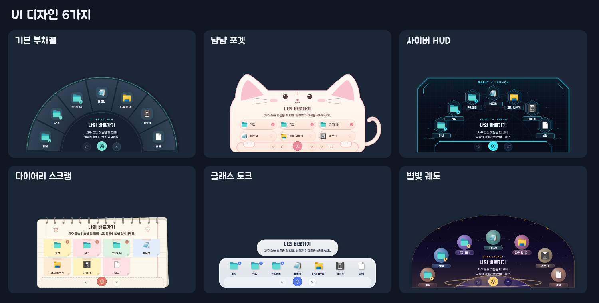

# 작업표시줄 런처 (DeckLauncher)

작업표시줄 아이콘을 누르면 부채꼴(또는 고른 디자인)로 펼쳐지는 Windows용 앱 런처입니다.
자주 쓰는 프로그램을 폴더로 묶고, 아이콘·메모·배경 이미지·색상·글꼴을 마음대로 꾸밀 수 있습니다.

## 소개 영상
[](https://enedaze-sub.github.io/taskbar-launcher/)

▶ **[전체 영상 보기 (1분 4초)](https://enedaze-sub.github.io/taskbar-launcher/)** · 위 미리보기는 1.5배속입니다.

런처 펼치기 · 폴더 펼침 · 런처 설정 · 색상/UI 디자인 · 배경 꾸미기를 1분 남짓 보여 줍니다. (런처 바깥 화면은 블러 처리)




## 설치

**필요한 것:** Windows 10/11 (x64), [.NET 6 Desktop Runtime (x64)](https://dotnet.microsoft.com/download/dotnet/6.0)

### 방법 1 · ZIP 내려받기
1. [Releases](../../releases)에서 최신 `taskbar-launcher-vX.zip`을 내려받아 압축을 풉니다.
2. `실행파일\DeckLauncher.exe`를 실행합니다.
3. 작업표시줄에 나타난 아이콘을 우클릭 → **작업 표시줄에 고정**.

### 방법 2 · git으로 설치
```bash
git clone https://github.com/enedaze-sub/taskbar-launcher.git
```
`taskbar-launcher\실행파일\DeckLauncher.exe`를 실행합니다. 새 버전은 `git pull`로 받습니다.
등록 정보는 `실행파일\Data`에 저장되며 git이 건드리지 않습니다.

## 사용법 요약
- **등록:** 실행 파일(.exe)이나 바로가기를 런처 설정 창에 끌어다 놓으면 끝입니다.
  작업표시줄에만 있는 앱은 설정 창의 **직접 등록**에서 바로가기 ‘대상’을 붙여 넣으세요.
- **꾸미기:** 설정 창 → 꾸미기 → 색상 · UI 디자인(부채꼴 · 냥냥 포켓 · 사이버 HUD · 다이어리 스크랩 · 글래스 도크 · 별빛 궤도) / 전체 배경 이미지 / 글꼴
- **옵션(···):** 휠 다이얼, 백업 · 복원, 저장 폴더 열기, 런처 종료
- 단축키: `Home` 처음으로 · `Esc` 상위 폴더/숨기기 · `PageUp/PageDown` 페이지 · `Ctrl+F` 설정

자세한 내용은 [사용안내.txt](사용안내.txt)를 보세요.

## Linux · macOS 버전

기존 Windows 버전과 별도로 Qt/Python 기반 Linux·macOS 버전을 제공합니다. 폴더와 드래그 정렬, 메모, 디자인 6종·색상 10종·커스텀 테마, 전체/칸별 배경 미리보기, 선택형 휠 다이얼, 백업을 지원합니다.

| 대상 | 설치 패키지 | 사용안내 |
|---|---|---|
| Ubuntu 일반 PC, x86_64 | [Linux 내려받기](https://github.com/enedaze-sub/taskbar-launcher/releases/download/ports-2026.10.13/DeckLauncher-Linux-x86_64.tar.gz) | [리눅스 안내](리눅스/README.md) |
| macOS 14.4+, Apple Silicon/Intel | [macOS 내려받기](https://github.com/enedaze-sub/taskbar-launcher/releases/download/ports-2026.10.13/DeckLauncher-macOS.tar.gz) | [Mac 안내](macOS/README.md) |

**[Linux/macOS 미리보기 배포](https://github.com/enedaze-sub/taskbar-launcher/releases/tag/ports-2026.10.13)**입니다. 자동 검사 Linux 84개·macOS 102개와 Qt 렌더링을 Windows에서 확인했으며, 실제 Ubuntu/Mac 설치와 Dock 동작은 실기 검증 전입니다. 기존 Windows 릴리스는 그대로 유지합니다.

Linux는 패키지를 풀고 `bash install.sh --with-system-deps`를 실행합니다. Mac은 최초 빌드에 Python 3.10~3.15와 Apple Command Line Tools가 필요하며, `install.command`로 `~/Applications/DeckLauncher.app`을 만듭니다. 완성된 Mac 앱은 Python 없이 실행할 수 있습니다. Apple Developer ID 서명/공증은 포함하지 않습니다.

Windows/Linux 백업의 폴더·메모·이미지를 가져올 수 있습니다. 다른 운영체제의 실행 대상은 해당 OS 앱으로 다시 연결해야 합니다. 정확한 Dock 아이콘 좌표 대신 커서와 작업 영역을 기준으로 배치합니다.

### macOS UI 디자인 6종


[색상 테마 10종 보기](macOS/screenshots/colors.png) · [Mac 설정창](macOS/screenshots/settings.png) · [Linux UI 디자인 6종](리눅스/screenshots/designs.png)

위 이미지는 해당 버전의 소스를 Qt로 렌더링한 미리보기입니다. Mac/Linux 기본 앱 아이콘은 실제 설치된 앱과 OS를 따릅니다.

## 직접 빌드
.NET 6 SDK가 있으면 Windows PowerShell에서:
```powershell
.\소스\빌드.ps1            # 실행파일 폴더로 빌드 (실행 중인 런처는 먼저 종료)
.\소스\빌드.ps1 D:\out     # 다른 폴더로 빌드
```
자동 검사: `DeckLauncher.exe --self-test <결과폴더>` · 화면 미리보기: `DeckLauncher.exe --preview <폴더>` · 메모리 측정: `DeckLauncher.exe --memtest <Data 복사본> <결과폴더> [software]`

## 브랜치와 버전
| 이름 | 내용 |
|---|---|
| `main` | 최신 버전 |
| `backup/v1` … `backup/vN` | 각 버전 시점의 백업 브랜치 (태그 `v1` … `vN`과 같은 지점) |
| Releases | 버전별 배포 ZIP (개인 데이터 미포함) |

## 라이선스
[](https://creativecommons.org/licenses/by-nc/4.0/deed.ko)

이 프로젝트는 [크리에이티브 커먼즈 저작자표시-비영리 4.0 국제 라이선스(CC BY-NC 4.0)](https://creativecommons.org/licenses/by-nc/4.0/deed.ko)를 따릅니다.
저작자(enedaze)와 출처를 표시하면 자유롭게 복제·배포·수정할 수 있지만, **영리 목적으로는 이용할 수 없습니다.** 자세한 내용은 [LICENSE](LICENSE)를 보세요.

### 함께 들어 있는 글꼴
동봉 글꼴 [주아](https://fonts.google.com/specimen/Jua)·[고운돋움](https://fonts.google.com/specimen/Gowun+Dodum)은 SIL Open Font License를 따릅니다(`소스/Fonts/OFL.txt`).
카페24 써라운드 등 PC에 설치된 글꼴은 동봉하지 않으며, 없으면 동봉 글꼴로 대체됩니다.
