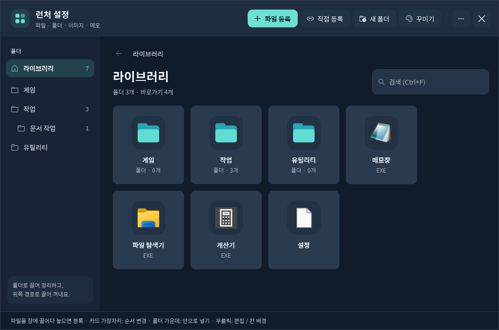

# 작업표시줄 런처 (DeckLauncher)

작업표시줄 아이콘을 누르면 부채꼴(또는 고른 디자인)로 펼쳐지는 Windows용 앱 런처입니다.
자주 쓰는 프로그램을 폴더로 묶고, 아이콘·메모·배경 이미지·색상·글꼴을 마음대로 꾸밀 수 있습니다.




## 설치

**필요한 것:** Windows 10/11 (x64), [.NET 6 Desktop Runtime (x64)](https://dotnet.microsoft.com/download/dotnet/6.0)

### 방법 1 · ZIP 내려받기
1. [Releases](../../releases)에서 최신 `taskbar-launcher-vX.zip`을 내려받아 압축을 풉니다.
2. `실행파일\DeckLauncher.exe`를 실행합니다.
3. 작업표시줄에 나타난 아이콘을 우클릭 → **작업 표시줄에 고정**.

### 방법 2 · git으로 설치
```bash
git clone https://github.com/enedaze-sub/taskbar-launcher.git
```
`taskbar-launcher\실행파일\DeckLauncher.exe`를 실행합니다. 새 버전은 `git pull`로 받습니다.
등록 정보는 `실행파일\Data`에 저장되며 git이 건드리지 않습니다.

## 사용법 요약
- **등록:** 실행 파일(.exe)이나 바로가기를 런처 설정 창에 끌어다 놓으면 끝입니다.
  작업표시줄에만 있는 앱은 설정 창의 **직접 등록**에서 바로가기 ‘대상’을 붙여 넣으세요.
- **꾸미기:** 설정 창 → 꾸미기 → 색상 · UI 디자인(부채꼴 · 냥냥 포켓 · 사이버 HUD · 다이어리 스크랩 · 글래스 도크 · 별빛 궤도) / 전체 배경 이미지 / 글꼴
- **옵션(···):** 휠 다이얼, 백업 · 복원, 저장 폴더 열기, 런처 종료
- 단축키: `Home` 처음으로 · `Esc` 상위 폴더/숨기기 · `PageUp/PageDown` 페이지 · `Ctrl+F` 설정

자세한 내용은 [사용안내.txt](사용안내.txt)를 보세요.

## 직접 빌드
.NET 6 SDK가 있으면 Windows PowerShell에서:
```powershell
.\소스\빌드.ps1            # 실행파일 폴더로 빌드 (실행 중인 런처는 먼저 종료)
.\소스\빌드.ps1 D:\out     # 다른 폴더로 빌드
```
자동 검사: `DeckLauncher.exe --self-test <결과폴더>` · 화면 미리보기: `DeckLauncher.exe --preview <폴더>`

## 브랜치와 버전
| 이름 | 내용 |
|---|---|
| `main` | 최신 버전 |
| `backup/v1` … `backup/vN` | 각 버전 시점의 백업 브랜치 (태그 `v1` … `vN`과 같은 지점) |
| Releases | 버전별 배포 ZIP (개인 데이터 미포함) |

## 글꼴
동봉 글꼴 [주아](https://fonts.google.com/specimen/Jua)·[고운돋움](https://fonts.google.com/specimen/Gowun+Dodum)은 SIL Open Font License를 따릅니다(`소스/Fonts/OFL.txt`).
카페24 써라운드 등 PC에 설치된 글꼴은 동봉하지 않으며, 없으면 동봉 글꼴로 대체됩니다.
