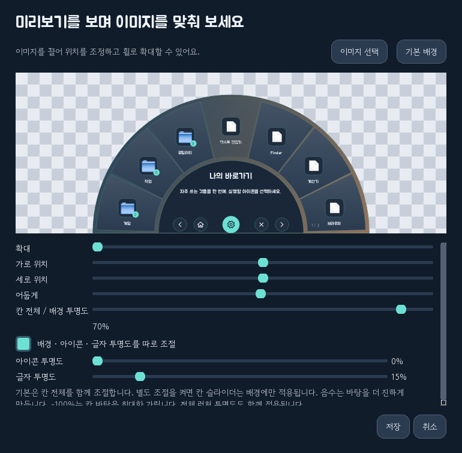
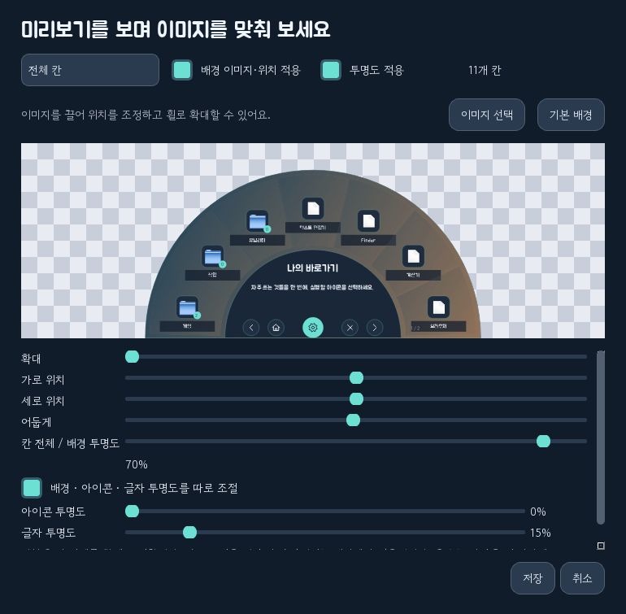
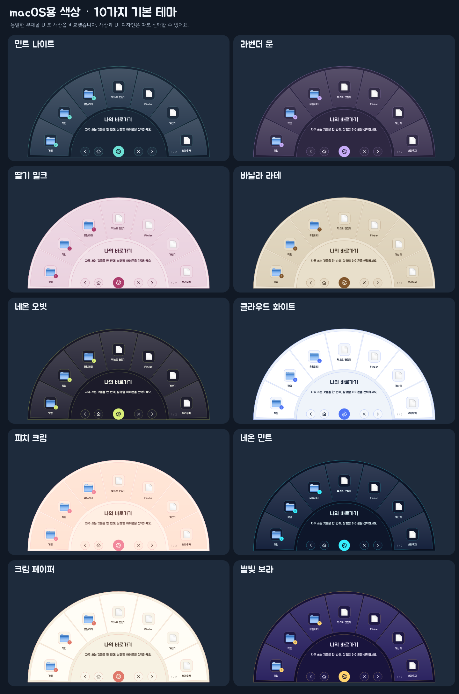

# 나의 작은 런처 · macOS

**[설치 패키지 내려받기](https://github.com/enedaze-sub/taskbar-launcher/releases/download/ports-2026.10.13/DeckLauncher-macOS.tar.gz)** · [Linux/macOS 배포 안내](https://github.com/enedaze-sub/taskbar-launcher/releases/tag/ports-2026.10.13)

Windows 버전의 최신 디자인과 기능을 Qt/Python으로 옮긴 Linux 버전을 바탕으로, Mac의 앱 번들·Dock·메뉴 막대에 맞춰 수정한 버전입니다. **이 압축은 완성된 `.app`이 아니라, Mac에서 한 번 실행해 `.app`을 만드는 설치 패키지입니다.**

## 백업 파일명 개선 (2026-10-14)

기본 파일명은 `DeckLauncher-backup-20261014-141530.zip`처럼 날짜와 시간을 초까지 표시합니다. 같은 이름이 있으면 `_2`, `_3`를 붙여 기존 백업을 보존합니다. 저장 완료 메시지에서 실제 저장 위치를 확인할 수 있습니다.

## 문구 · 배경 · 투명도 (v8.2)

- **… → 중앙 문구 수정:** 제목과 중앙 안내를 직접 작성합니다.
- **꾸미기 → 전체 배경 이미지:** 전체 런처 투명도도 여기서 조절합니다.
- **칸 우클릭 → 이 칸의 배경 이미지:** 칸 투명도(-100~85%)와 이미지 위치를 조절합니다. 음수는 바탕을 더 진하게 만듭니다.
- 기본은 칸 전체를 함께 조절합니다. **배경 · 아이콘 · 글자 투명도를 따로 조절**을 켜면 아이콘과 글자를 각각 0~100%로 조절할 수 있습니다. 예: 배경 70%, 아이콘·글자 0%는 흐릿한 배경 위에 선명한 아이콘·글자를 표시합니다.
- **꾸미기 → 칸 배경 일괄 설정:** 전체 / 현재 폴더 / 하위 폴더 포함 범위를 선택합니다. 이미지와 투명도는 각각 적용할 수 있습니다.
- 백업 이름에 시간·초를 추가했으며, 중복된 이름에는 숫자를 붙여 기존 백업을 보존합니다.

자동 검사 Windows 201개 · Linux 126개 · macOS 144개 통과. [자세한 변경·사용 안내](docs/v8.2.md).





## 테마 미리보기

Mac용 소스를 Windows의 Qt에서 렌더링한 화면입니다. 실제 Mac 앱 아이콘과 Dock 동작은 실기에서 확인해야 합니다.


<details>
<summary>기본 색상 테마 10종 보기</summary>



</details>

## 설치

대상은 **macOS 14.4 이상, Apple Silicon 또는 Intel Mac**입니다. 기본 설치는 설치하는 Mac의 실행 아키텍처에 맞춰 앱을 만듭니다. M 시리즈 Mac에서는 Rosetta로 실행하는 터미널 대신 일반 터미널을 사용하세요.

최초 설치 준비:

1. [Python 공식 Mac 설치기](https://www.python.org/downloads/macos/)로 **Python 3.10~3.15** 중 하나를 설치합니다. 공식 universal2 설치기를 권장합니다.
2. 터미널에서 `xcode-select --install`을 실행해 Apple Command Line Tools를 설치합니다. 이미 설치되어 있다면 건너뜁니다. 전체 Xcode 앱 설치는 필요하지 않습니다.
3. `DeckLauncher-macOS.tar.gz`를 Mac으로 옮겨 더블클릭해서 풉니다.
4. 풀린 `DeckLauncher-macOS` 폴더의 **`install.command`**를 더블클릭합니다. 설치 진행 창이 열립니다. 더블클릭이 막히면 터미널에 `bash `를 입력하고 `install.command`를 끌어다 놓은 뒤 Enter를 누르세요.
5. 설치가 끝나면 Finder의 홈 폴더 → **Applications → DeckLauncher.app**을 실행합니다. 사용자 홈의 Applications 폴더이며 시스템 전체의 응용 프로그램 폴더와 다릅니다.
6. Dock의 런처 아이콘을 우클릭 → **옵션 → Dock에 유지**를 선택합니다.

처음 만들 때만 Python과 Command Line Tools가 필요합니다. **생성된 `.app`에는 Python·Qt·글꼴이 포함되어 이후 실행에는 별도 Python 설치가 필요하지 않습니다.** 앱을 만들 때 필요한 Mac용 구성요소 8개도 압축에 들어 있습니다. Python/Apple 도구를 준비한 다음의 기본 설치는 구성요소를 인터넷에서 받지 않습니다.

첫 실행은 빈 라이브러리로 시작합니다. Windows의 개인 등록 정보는 배포 파일에 넣지 않았습니다.

## 사용하는 방법

- Dock 아이콘을 클릭하면 런처가 펼쳐집니다. 앱 실행 성공 후나 다른 앱·Finder로 전환하면 숨깁니다. Dock 아이콘을 다시 클릭하거나 메뉴 막대/메뉴의 **런처 열기**로 다시 엽니다.
- 가운데 톱니바퀴 또는 Mac 앱 메뉴의 **런처 설정…**으로 설정합니다. 앱 종료는 앱 메뉴의 **DeckLauncher 종료** 또는 ⌘Q입니다. 런처의 X는 숨기는 버튼입니다.
- **설치된 앱**에서 Mac의 응용 프로그램/시스템 앱/사용자 Applications 폴더를 검색해 여러 앱을 등록할 수 있습니다. `.app` 내부의 실행 파일을 찾을 필요가 없습니다.
- Finder에서 `.app`, 문서, 폴더, 실행 가능한 스크립트를 목록이나 런처에 끌어다 놓을 수 있습니다. **직접 등록**에서는 웹 주소나 명령 이름도 사용할 수 있습니다.
- 예: `/Applications/Safari.app`, `/System/Applications/Calculator.app`, `https://example.com`. 실행 인수는 대상 주소와 합치지 않고 **실행 인수** 칸에 입력하세요. 인수가 있는 `.app`은 `open -a … --args …` 방식으로 엽니다. 이미 켜진 앱이 새 인수를 무시하는 경우 앱을 종료한 뒤 다시 실행하세요.
- 폴더에 마우스를 올리면 내부 목록이 옆에 펼쳐집니다. 중첩 폴더에도 적용됩니다. 폴더 클릭으로 내부로 들어가는 방식도 사용할 수 있습니다.
- 설정 목록에서 끌어서 순서를 바꾸거나 폴더에 넣습니다. 아래 **라이브러리로 꺼내기** 영역에 놓으면 최상위로 이동합니다. 런처에서도 끌어서 폴더로 이동하거나 표시 순서를 바꿀 수 있습니다.
- **꾸미기**에서 디자인 6종·색상 10종·별도 커스텀 테마·런처와 설정창 글꼴을 고릅니다. Jua와 Gowun Dodum이 동봉됩니다. Mac에 설치한 글꼴도 사용할 수 있습니다.
- 전체 배경 또는 각 칸의 배경 이미지를 선택한 후 실제 모양의 미리보기에서 드래그로 위치를 조정합니다. 확대와 어둡기도 조절할 수 있습니다. 앱 기본 아이콘 대신 원하는 이미지도 설정할 수 있습니다.
- 페이지는 기본적으로 이전/다음 버튼으로 넘깁니다. **… → 마우스 휠로 다이얼 돌리기**를 켜면 순환 이동을 사용합니다. 메모는 항목을 가리키면 표시됩니다.

## Dock과 창 배치

Mac의 일반 앱 창으로 실행하며 최상단에 고정하지 않습니다. 별도의 접근성 권한이나 입력 모니터링 권한을 요구하지 않습니다. 런처의 자동 숨김은 앱 활성 상태가 바뀌는 것을 이용합니다. 설정창은 일반 앱 창처럼 다른 앱 뒤로 갑니다.

**… → 독 배치 설정**에서 아래/위/왼쪽/오른쪽, 클릭 위치 또는 화면 중앙, 간격을 지정할 수 있습니다. 자동은 커서 가까운 화면 가장자리에 펼칩니다. Dock 아이콘의 정확한 위치를 읽는 기능은 없으며 **클릭 위치와 화면 작업 영역**을 기준으로 배치합니다. Dock 자동 숨김, 확대, 여러 모니터, Spaces/전체 화면의 실제 동작은 Mac에서 확인해야 합니다.

## 기존 등록 정보를 가져오기

Windows 또는 Linux 버전에서 **백업 저장**으로 만든 ZIP을 Mac에 옮긴 뒤 **… → 백업 가져오기**를 선택하세요. 폴더·순서·메모·사용자 이미지·테마는 유지하며 가져오기 전 Mac 목록은 자동 백업합니다.

Windows `.exe`/`.lnk`와 Linux `.desktop`/AppImage는 Mac에서 실행할 수 없습니다. 항목을 **편집**해 Mac의 해당 `.app`이나 파일로 다시 연결하세요. 다른 운영체제에만 있는 앱은 대응 앱을 선택해야 합니다. Mac에 없는 글꼴은 동봉 글꼴로 표시합니다. 운영체제별 배치 설정은 별도로 보관합니다.

데이터: `~/Library/Application Support/DeckLauncher/`의 `library.json`, `Icons/`, 이전 저장 파일. 앱을 업데이트하거나 삭제해도 이 데이터는 남습니다. 업데이트할 때는 모든 런처 인스턴스를 종료한 뒤 `install.command`를 다시 실행하세요. 같은 식별자의 기존 앱은 숨김 보관 폴더에 남겨 둡니다.

## 설치 옵션과 문제 확인

설치 폴더의 터미널에서:

```sh
# 기본 사용자 설치
bash install.command
# 다른 위치
bash install.command --destination "$HOME/Applications/SmallLauncher.app"
# 공식 universal2 Python으로 Intel + Apple Silicon 공용 앱 생성
bash install.command --universal
# 동봉 wheel 대신 같은 고정 버전을 PyPI에서 설치
bash install.command --online
```

공용 앱은 Python 자체도 universal2여야 합니다. 기본 설치는 현재 Python 실행 아키텍처 한 가지용입니다. 같은 CPU의 다른 Mac에 복사할 수 있지만 대상 OS가 14.4 이상이어야 하며, 배포 전 실제 Mac에서 실행을 확인하세요.

개인용으로 로컬에서 ad-hoc 서명합니다. **Apple Developer ID 서명·공증을 완료한 배포 앱은 아닙니다.** 다른 Mac에 옮기거나 다운로드한 파일은 macOS가 실행을 제한할 수 있습니다. 출처를 확인한 파일에 한해 Apple 안내의 **시스템 설정 → 개인정보 보호 및 보안 → 그래도 열기** 절차를 사용하세요. [Apple의 확인되지 않은 개발자 앱 열기 안내](https://support.apple.com/guide/mac-help/open-a-mac-app-from-an-unknown-developer-mh40616/mac). 보안 설정을 전체적으로 끄는 작업은 설치기가 하지 않습니다.

문제 로그가 필요하면 다음과 같이 생성된 앱 내부의 실행 파일을 터미널에서 실행하세요.

```sh
"$HOME/Applications/DeckLauncher.app/Contents/MacOS/DeckLauncher"
"$HOME/Applications/DeckLauncher.app/Contents/MacOS/DeckLauncher" --self-test
```

Git으로 소스만 받은 경우 `wheels/`가 포함되지 않습니다. **`bash install.command --online`**으로 설치하세요. 아래의 오프라인 소스 실행 명령은 전체 설치 패키지를 푼 경우에 사용합니다.

소스 실행/검사:

```sh
python3 -m venv .venv
.venv/bin/python -m pip install --no-index --find-links wheels -r requirements.txt
.venv/bin/python run.py
.venv/bin/python run.py --self-test
.venv/bin/python run.py --preview preview
```

삭제는 런처를 종료한 뒤 `.app`을 휴지통으로 옮기면 됩니다. 사용자 데이터는 별도로 남습니다. 생성된 앱에서 사용하지 않는 빌드 환경은 `~/Library/Caches/DeckLauncher/`에 있습니다.

## 검증 범위와 라이선스

2026-10-13: Windows의 Qt 6.12.0 offscreen 환경에서 **자동 검사 144개 통과**, 6종 디자인/설정/도움말 렌더링과 중복 실행 통신을 확인했습니다. Mac용 wheel의 SHA256은 PyPI 공개 메타데이터와 대조했습니다. **실제 Mac 설치·Cocoa/Dock·macOS 앱 실행·코드 서명은 실기 검증하지 못했습니다.** Windows에서 Mac용 `.app`을 빌드했다고 표시하지 않습니다.

Qt 6.12의 [지원 플랫폼](https://doc.qt.io/qt-6.12/supported-platforms.html), PyInstaller의 [Mac 아키텍처 및 서명 안내](https://pyinstaller.org/en/stable/feature-notes.html#macos-multi-arch-support)를 기준으로 구성했습니다.

프로젝트의 기존 CC BY-NC 4.0 라이선스를 유지합니다. Qt/PySide·글꼴·빌드 도구는 각각 원래 라이선스를 따릅니다. `THIRD_PARTY_NOTICES.md`와 `third_party_licenses/`에 원문 및 출처가 있습니다. 전체 실행 소스를 함께 제공하며 Qt/PySide를 교체하고 설치기로 `.app`을 다시 만들 수 있습니다.
