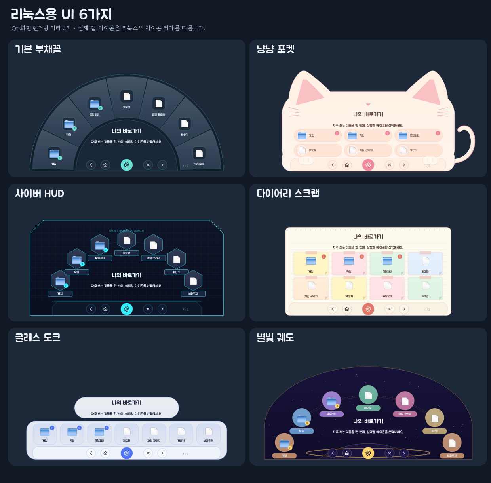

# DeckLauncher Linux · 나의 작은 런처

**[설치 패키지 내려받기](https://github.com/enedaze-sub/taskbar-launcher/releases/download/ports-2026.10.13/DeckLauncher-Linux-x86_64.tar.gz)** · [Linux/macOS 배포 안내](https://github.com/enedaze-sub/taskbar-launcher/releases/tag/ports-2026.10.13)

Windows 버전의 최신 Git 상태 `f586b00`(v8.1 이후)를 기준으로 만든 리눅스용 데스크톱 런처입니다. 기존 Windows 소스와 실행 파일은 그대로 유지하고, 리눅스 화면과 앱 실행 부분을 Python + Qt로 별도 구현했습니다.

**대상:** Ubuntu 22.04/24.04/26.04 계열 일반 PC, x86_64, Python 3.10~3.15. X11 또는 XWayland가 있는 일반 데스크톱을 기준으로 준비했습니다. 다른 배포판·ARM64는 필요한 Qt와 시스템 라이브러리를 따로 설치해야 합니다.

**검증 상태:** Windows에서 동일한 Qt 화면을 렌더링하고 132개 자동 검사를 통과했습니다. 실제 Ubuntu 설치, GNOME/KDE 독 클릭, Linux 시스템 앱 실행, XInput2 바깥 클릭 감지는 아직 실기 검증하지 않았습니다. 패키지를 실기 검증 완료 버전으로 표시하지 않습니다.

## 백업 파일명 개선 (2026-10-14)

기본 파일명은 `DeckLauncher-backup-20261014-141530.zip`처럼 날짜와 시간을 초까지 표시합니다. 같은 이름이 있으면 `_2`, `_3`를 붙여 기존 백업을 보존합니다. 저장 완료 메시지에서 실제 저장 위치를 확인할 수 있습니다.

## 100% 투명도 (v8.3)

- 칸 우클릭 → **이 칸의 배경 이미지** / 꾸미기 → **칸 배경 일괄 설정**의 칸 투명도 범위는 **-100~100%**입니다. 기존 85% 상한을 제거했습니다.
- 기본은 배경·아이콘·글자를 함께 조절합니다. 별도 조절을 켜고 **배경 100% / 아이콘·글자 0%**로 설정하면 배경만 완전히 숨깁니다.
- **꾸미기 → 전체 배경 이미지**에서 런처 전체도 **0~100%**로 조절합니다. 전체가 100%이면 작업표시줄/Dock 아이콘을 눌렀을 때 설정창을 열어 다시 조절할 수 있습니다.
- 기존 등록 정보와 음수 범위, 일괄 적용, 문구 수정, 백업 파일명 개선은 유지합니다.
- 영어·일본어·중국어 간체 README와 대표색 테마 미리보기는 [프로젝트 README](https://github.com/enedaze-sub/taskbar-launcher#readme)에서 확인하세요. 앱 UI는 현재 한국어입니다.

[자세한 변경·설치 안내](docs/v8.3.md)

## UI 미리보기

Linux용 소스를 Windows의 Qt에서 렌더링한 화면입니다. 실제 Linux의 기본 앱 아이콘은 설치된 아이콘 테마를 따릅니다.



Git으로 소스만 받은 경우 `wheels/`가 포함되지 않습니다. `bash install.sh --online --with-system-deps`로 설치하세요. 아래의 오프라인 설치는 전체 설치 패키지를 푼 경우에 사용합니다.

## Ubuntu에서 설치하기

1. `DeckLauncher-Linux-x86_64.tar.gz`를 리눅스 PC로 옮기고 압축을 풉니다.
2. `DeckLauncher-Linux` 폴더 안에서 터미널을 엽니다.
3. 처음 설치라면 아래 명령을 실행합니다. 시스템 라이브러리가 없을 때만 관리자 권한을 사용하고, 런처 자체는 일반 사용자 폴더에 설치합니다.

```bash
bash install.sh --with-system-deps
```

이미 Python 가상 환경과 Qt 시스템 라이브러리가 준비되어 있으면:

```bash
bash install.sh
```

4. 앱 목록에서 **나의 작은 런처 / DeckLauncher**를 실행합니다.
5. Ubuntu 독의 런처 아이콘을 우클릭 → **즐겨찾기에 추가**합니다. KDE에서는 작업 관리자에 고정하세요. 숨겨진 뒤에도 고정 아이콘으로 다시 열 수 있습니다.

동봉 wheel은 Linux x86_64용 PySide6-Essentials 6.12.0 / shiboken6 6.12.0입니다. Qt는 이 파일에서 설치되므로 다운로드가 필요 없습니다. 다만 `--with-system-deps`의 Ubuntu 패키지 설치에는 인터넷이 필요할 수 있습니다. ARM64 등은 `bash install.sh --online`을 사용하세요. 해당 아키텍처의 wheel이 제공되는지는 별도 확인이 필요합니다.

**설치에 sudo를 직접 붙이지 마세요.** `sudo bash install.sh`가 아니라 일반 사용자로 실행해야 합니다. 시스템 패키지 설치 단계만 설치기가 sudo를 요청합니다.

## 처음 사용할 때

- 톱니바퀴 → **설치된 앱**에서 원하는 앱을 골라 등록합니다. Flatpak·Snap의 표준 바로가기 폴더도 검색합니다.
- **직접 등록**에서 실행 파일, AppImage, 스크립트, 문서, 폴더, 명령 이름, 웹 주소를 등록할 수 있습니다. 실행 인수는 별도 칸에 넣습니다.
- 파일 관리자의 `.desktop` 바로가기나 파일을 목록에 끌어다 놓아도 됩니다.
- 폴더는 **새 폴더**로 만듭니다. 항목을 폴더 가운데로 끌면 안으로 들어갑니다. 폴더의 위·아래 또는 아이콘 양 끝에 놓으면 순서를 바꿉니다.
- 설정창 아래 **라이브러리로 꺼내기 · 여기에 놓기**에 놓으면 맨 바깥으로 나옵니다. **상위 폴더로 꺼내기**로 한 단계만 꺼낼 수도 있습니다.
- 런처에서도 아이콘을 끌어 순서를 바꾸거나 폴더에 담을 수 있습니다. 하단 집/뒤로 버튼에 놓으면 상위 폴더로 꺼냅니다.
- 폴더에 마우스를 올리면 옆으로 내부 목록이 나타납니다. 내부 폴더도 연이어 펼칠 수 있습니다. 직접 클릭해 폴더 안으로 들어가는 방식도 지원합니다.
- 메모는 마우스를 올릴 때 중앙과 툴팁에 표시합니다. 실행 성공 후에는 런처를 숨깁니다.
- 바깥 앱으로 전환하면 숨깁니다. X11에서는 XInput2를 사용할 수 있을 때 바깥 클릭도 관찰합니다. 클릭을 가로채거나 마우스 기록을 저장하지 않습니다.
- 이전/다음 버튼이 기본 페이지 이동입니다. **··· → 마우스 휠로 다이얼 돌리기**를 켜면 한 항목씩 순환합니다.

## 꾸미기

**색상 10종:** 민트 나이트, 라벤더 문, 딸기 밀크, 바닐라 라테, 네온 오빗, 클라우드 화이트, 피치 크림, 네온 민트, 크림 페이퍼, 별빛 보라. 최신 Windows와 같은 구성입니다.

**UI 디자인 6종:** 기본 부채꼴, 냥냥 포켓, 사이버 HUD, 다이어리 스크랩, 글래스 도크, 별빛 궤도. 색과 모양은 각각 선택합니다. 리눅스 Qt로 형태·배치를 다시 그린 버전이므로 WPF 그림자·장식과 픽셀 단위로 같지는 않습니다.

- 커스텀 구성에서 색상, 칸 수(5~9), 아이콘 크기, 아이콘 프레임, 부채꼴 반경·간격, 이름·메모 표시를 바꿉니다.
- **저장한 커스텀 테마**에 이름을 붙여 따로 보관합니다. 같은 이름으로 저장하면 해당 테마를 갱신합니다.
- 전체 배경과 항목별 배경을 각각 지정합니다. 실제 런처 모양으로 미리 보며 드래그·확대·위치·어둡기를 조절합니다.
- 기본 아이콘을 사용하거나 원하는 이미지로 바꿉니다. `.desktop` 앱은 바로가기의 아이콘 이름을 시스템 테마에서 찾습니다. 사용자 이미지는 프로그램 저장 폴더로 복사됩니다.
- 런처와 설정창의 글꼴을 따로 고릅니다. 동봉한 **주아 / 고운돋움**을 기본으로 쓰며, PC에 설치된 글꼴도 선택할 수 있습니다. Windows에서 선택했던 글꼴이 없으면 동봉 글꼴로 대체합니다.
- 메모·테마·글꼴·배경 편집창에서 취소하면 설정을 적용하지 않습니다.

## 독과 창 위치

기본값은 **클릭 위치로 자동**입니다. 클릭한 위치에 가까운 화면 가장자리를 고르고, 해당 모니터 작업 영역 안에 펼칩니다. Ubuntu의 왼쪽 독과 아래쪽 패널을 모두 고려했습니다. **··· → 독 배치 설정**에서 위/아래/왼쪽/오른쪽, 클릭 위치/중앙, 간격을 직접 정할 수 있습니다.

각 데스크톱은 독 아이콘의 정확한 좌표를 공통 API로 제공하지 않습니다. 따라서 **마우스 클릭 위치와 작업 영역을 기준으로 배치**하며 Windows처럼 아이콘 좌표를 직접 읽지는 않습니다. KDE·GNOME의 고정 아이콘 재클릭은 창 활성화/최소화 정책에 따라 달라집니다. 최소화될 때는 런처를 숨기며, 바로가기로 새 실행 요청이 오면 기존 인스턴스와 통신해 열기/숨기기를 전환합니다. 트레이가 제공되는 환경에는 트레이 메뉴도 만듭니다.

일반 Wayland 클라이언트는 창 위치를 강제로 지정할 수 없습니다. 이 버전은 Ubuntu Wayland 세션에 `DISPLAY`가 있을 때 기본적으로 **XWayland(xcb)**를 사용합니다. 따라서 Wayland로 로그인했더라도 독 배치가 가능한 XWayland 창으로 실행합니다. 순수 Wayland는 앱을 열 수 있으나 위치·창 마스크·전역 바깥 클릭 기능이 제한될 수 있습니다.

```bash
# 필요할 때만 순수 Wayland로 직접 실행
QT_QPA_PLATFORM=wayland bash ~/.local/share/decklauncher-app/run.sh
```

## Windows 등록 정보 가져오기

1. Windows 런처 설정에서 **··· → 백업 저장**으로 ZIP을 만듭니다.
2. 해당 백업을 리눅스 PC에 옮깁니다.
3. 리눅스 설정에서 **··· → 백업 가져오기**를 선택합니다.
4. 폴더, 순서, 메모, 사용자 아이콘, 배경, 커스텀 테마를 확인합니다.
5. Windows 경로인 앱은 **편집**에서 리눅스 앱의 `.desktop` 경로 또는 실행 파일로 다시 연결합니다.

Windows `.exe`·`.lnk`를 리눅스 앱으로 자동 변환하지 않습니다. Wine 실행이 필요한 경우 실행 대상을 `wine`, 인수를 해당 파일 경로로 직접 설정할 수 있지만 Wine은 동봉하지 않습니다. Windows 백업을 가져올 때 원래 Windows PC의 파일은 수정하지 않습니다. Linux 기존 목록은 가져오기 전 ZIP으로 자동 보관합니다.

## 저장 위치와 실행

- 앱: `~/.local/share/decklauncher-app`
- 등록·이미지: `~/.local/share/decklauncher/library.json`, `icons/`
- `XDG_DATA_HOME`이 지정된 경우 그 경로를 사용합니다.
- 이전 JSON은 `library.json.bak`에 남깁니다.
- 같은 저장 폴더로 실행하면 인스턴스를 중복 생성하지 않습니다.

```bash
# 런처 열기/숨기기
bash ~/.local/share/decklauncher-app/run.sh
# 설정만 열기
bash ~/.local/share/decklauncher-app/run.sh --settings
# 다른 데이터 폴더로 독립 실행
bash ~/.local/share/decklauncher-app/run.sh --data-dir /원하는/경로
```

삭제는 압축을 풀었던 폴더에서 `bash uninstall.sh`입니다. 프로그램 파일을 지우고 등록 정보·이미지·백업은 남겨 둡니다. 실행 중인 런처는 먼저 **··· → 런처 종료**로 끝내세요.

## 단축키

`Home` 처음으로 · `Esc` 상위 폴더/숨기기 · `PageUp/PageDown` 이전/다음 페이지 · `Ctrl+F` 설정

## 문제가 생겼을 때

- **xcb 플러그인 오류:** `bash install.sh --with-system-deps`로 Qt의 Ubuntu 시스템 라이브러리를 설치하세요. XWayland가 없는 순수 Wayland 환경이면 위치 기능이 제한됩니다.
- **Python 가상 환경 오류:** `sudo apt install python3-venv` 후 일반 사용자로 다시 설치하세요.
- **AppImage 실행 오류:** 파일 속성에서 실행 허용을 켜세요. 구형 AppImage는 FUSE 2가 필요할 수 있습니다. Ubuntu 24.04에서는 `sudo apt install libfuse2t64`를 사용할 수 있습니다. 이것은 등록 대상 AppImage의 요구사항이며 런처 자체는 AppImage가 아닙니다.
- **아이콘 누른 위치와 어긋남:** 독 배치 설정의 가장자리·정렬·간격을 조정하세요. 키보드로 실행하면 당시 마우스 위치를 사용합니다.
- **새 실행 요청이 연결되지 않음:** 이미 실행 중인 프로그램의 시작이 끝난 뒤 다시 실행하세요. 비정상 종료 뒤의 잠금은 Qt의 PID 확인으로 처리합니다.
- **저장 데이터를 읽지 못함:** `library.json`을 삭제하지 말고 `library.json.bak`와 비교하거나 저장한 ZIP을 복원하세요. 잘못된 JSON을 자동 초기화하지 않습니다.

## 소스에서 실행·검사

```bash
python3 -m venv .venv
.venv/bin/python -m pip install --no-index --find-links wheels -r requirements.txt
.venv/bin/python run.py
QT_QPA_PLATFORM=offscreen .venv/bin/python run.py --self-test
QT_QPA_PLATFORM=offscreen .venv/bin/python run.py --preview preview
```

핵심 코드: `model.py`(데이터·폴더·백업), `launch.py`(리눅스 앱), `view.py`(6종 화면), `dialogs.py`(설정), `app.py`(인스턴스·독 배치), `outside.py`(X11 바깥 클릭). Qt는 웹뷰를 사용하지 않으며 이미지 캐시 수와 로딩 크기를 제한합니다.

## 라이선스와 참고

원본 프로젝트의 CC BY-NC 4.0 라이선스를 유지합니다. Qt·PySide·글꼴은 각각 별도 라이선스가 적용됩니다. `LICENSE`, `THIRD_PARTY_NOTICES.md`, `Fonts/OFL.txt`, `third_party_licenses/`를 확인하세요.

- [Qt 창과 Wayland 위치 제한](https://doc.qt.io/qtforpython-6/overviews/qtwidgets-application-windows.html)
- [Qt Linux 시스템 요구사항](https://doc.qt.io/qtforpython-6/overviews/qtdoc-linux-requirements.html)
- [Freedesktop Desktop Entry 규격](https://specifications.freedesktop.org/desktop-entry/latest-single/)
- [AppImage FUSE 안내](https://docs.appimage.org/user-guide/troubleshooting/fuse.html)
